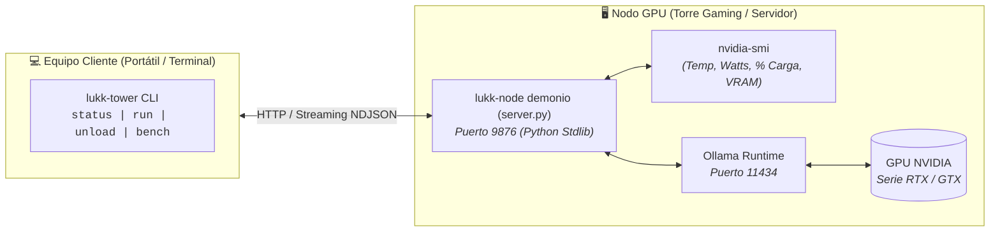

# 🛰️ LUKK-NODE: Telemetría Remota de GPU y Orquestador de LLMs Locales

[Read in English](README.md) | **[Leer en Español](README.es.md)**

[](https://www.python.org/)
[](LICENSE)
[]()
[]()

Un satélite cliente-servidor y CLI liviano, con **cero dependencias externas**, diseñado para desarrolladores y gamers que ejecutan modelos de IA locales (vía [Ollama](https://ollama.com)) en PCs o servidores dedicados con GPU.

Proporciona **telemetría de hardware NVIDIA en tiempo real**, **inferencia delegada con streaming continuo** y **desalojo instantáneo de VRAM (Modo Juego)** para garantizar que tu tarjeta gráfica esté al 100% disponible para videojuegos y tareas gráficas intensivas.

---

## ⚡ El Problema que Resuelve

Cuando ejecutas modelos locales (Llama 3, Qwen 2.5, DeepSeek) con Ollama en tu PC principal de trabajo o juegos:
1. **Secuestro de VRAM:** Ollama retiene los modelos cargados en la memoria de la GPU por defecto (`OLLAMA_KEEP_ALIVE=5m`). Si abres un videojuego exigente mientras un modelo sigue en VRAM, sufrirás caídas severas de FPS o cierres inesperados por falta de memoria gráfica.
2. **Ejecución Remota a Ciegas:** Al enviar prompts desde un portátil u otro equipo en la red local, generalmente no tienes visibilidad de las temperaturas del hardware, el consumo eléctrico (Watts) ni la velocidad real en tokens/segundo.
3. **Dependencias Pesadas:** Otras herramientas requieren interfaces pesadas (Electron/Tkinter), configuraciones complejas de llaves SSH o instalar decenas de paquetes en Python.

**LUKK-NODE** se ejecuta como un micro-demonio nativo en tu máquina con GPU utilizando **únicamente la biblioteca estándar de Python 3**, exponiendo una API REST ligera para telemetría, control de memoria y streaming de inferencia.

---

## 🏗️ Arquitectura



---

## 🚀 Inicio Rápido

### 1. En el Nodo con GPU (Windows o Linux)
Ejecuta el servidor satélite directamente. No requiere `pip install`:
```bash
python server.py
```
> **Tip para Windows:** Puedes hacer doble clic en `server.py` o programarlo en el Administrador de Tareas para que inicie con Windows.
> **Tip para Linux:** Puedes configurarlo como un servicio de usuario ligero en `systemd`.

### 2. En el Equipo Cliente (Portátil / Estación de Desarrollo)
Configura la dirección IP de tu nodo con GPU en la red local:
```bash
python client.py set-ip 192.168.1.X
```
*(Opcional: vincula `client.py` a `~/.local/bin/lukk-tower` para ejecutarlo como comando global en tu terminal).*

---

## 🛠️ Comandos y Flujos de Trabajo (`lukk-tower`)

### 📊 1. Telemetría de Hardware en Tiempo Real
Supervisa el estado térmico, consumo de energía y modelos residentes en la VRAM de tu GPU:
```bash
lukk-tower status
```
**Ejemplo de Salida:**
```text
========================================================
🖥️  TELEMETRÍA REMOTA GPU: GAMING-RIG (192.168.1.50)
========================================================
🎮 GPU Device:     NVIDIA GeForce RTX 3060
🌡️  Temperature:    54°C
⚡ Power Draw:     82.4 W
📊 Core Load:      [███░░░░░░░░░░░░] 22.0%
🧠 Memory (VRAM):  [█████████░░░░░░] 4.82 GB / 8.00 GB (60.2%)

--------------------------------------------------------
🤖 ESTADO DE RESIDENCIA OLLAMA EN VRAM
--------------------------------------------------------
🟣 Modelo Activo en VRAM: qwen2.5-coder:7b (Uso: 4850.0 MB VRAM)
========================================================
```

---

### 🎮 2. Modo Juego (Purga Instantánea de VRAM)
¿Listo para jugar? Desaloja de inmediato todos los modelos de la memoria de la gráfica en menos de 1 segundo:
```bash
lukk-tower unload
```
Ollama libera los pesos del modelo hacia el almacenamiento de disco. La GPU vuelve inmediatamente a **0 MB de consumo de IA**, lista para jugar en Steam al máximo rendimiento.

---

### 🧠 3. Inferencia Delegada con Streaming
Envía consultas de código, auditorías o prompts a tu equipo con GPU con **streaming de tokens en tiempo real**:
```bash
lukk-tower run "Implementa un limitador de tasa asíncrono con algoritmo leaky bucket en Python"
```

#### Auditoría de Código mediante Tuberías (`pipes / stdin`)
Pasa archivos o diffs de git directamente al modelo remoto:
```bash
git diff | lukk-tower run -p review "Analiza este diff en busca de regresiones, condiciones de carrera o casos borde"
```

#### Tarea Efímera (Auto-Desalojo de VRAM para Gamers)
Ejecuta una consulta y purga automáticamente la VRAM al terminar la respuesta:
```bash
lukk-tower run -u "Explica el plan de ejecución de esta consulta SQL"
```

#### Perfiles de Agente Disponibles (`-p`):
- `-p code`: Código modular, tipado y listo para producción con explicaciones directas (predeterminado).
- `-p review`: Auditor estricto de seguridad, concurrencia y fugas de memoria.
- `-p chat`: Asistente técnico conversacional conciso.
- `-p raw`: Prompt puro sin system prompt inyectado.

---

### ⚡ 4. Benchmark de Hardware
Ejecuta una prueba estándar de velocidad de generación y latencia en tu GPU remota:
```bash
lukk-tower bench --model qwen2.5-coder:7b
```
Muestra la velocidad real en tokens/segundo:
> `⚡ [51.4 tok/s | 312 tokens | 6.07s | VRAM: 4.8GB/8.0GB | 58°C | qwen2.5-coder:7b]`

---

## 📡 Referencia de la API REST

El satélite (`server.py`) escucha en el puerto `9876` y expone:

| Método | Endpoint | Descripción |
| :--- | :--- | :--- |
| `GET` | `/health` | Estado del servicio y nombre del nodo. |
| `GET` | `/telemetry` | Telemetría completa de GPU (`nvidia-smi`) + modelos activos en Ollama. |
| `GET` | `/models` | Lista todos los modelos descargados en el nodo. |
| `POST` | `/unload` | Desalojo forzado e inmediato de VRAM (`keep_alive: 0`). |
| `POST` | `/infer` | Inferencia delegada con streaming NDJSON o respuesta JSON completa. |

---

## 🔒 Aviso de Seguridad y Red Privada
`lukk-node` enlaza a las interfaces locales (`0.0.0.0:9876`). Está diseñado para redes locales privadas (LAN), redes malladas como Tailscale o enlaces localhost. Nunca expongas el puerto 9876 a internet público sin un proxy inverso con autenticación o una VPN.

---

## 📄 Licencia
Este proyecto es de código abierto bajo la [Licencia MIT](LICENSE).  
Desarrollado por **Rodrigo Henriquez** ([@SirFassler](https://github.com/SirFassler)).
