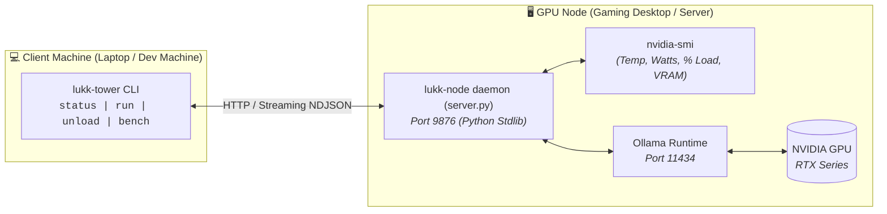

# 🛰️ LUKK-NODE: Remote GPU Telemetry & Local LLM Orchestrator

**[Read in English](README.md)** | [Leer en Español](README.es.md)

[](https://www.python.org/)
[](LICENSE)
[]()
[]()

A lightweight, zero-dependency client-server satellite daemon and CLI designed for developers and gamers running local LLMs (via [Ollama](https://ollama.com)) on dedicated GPU rigs.

Provides **real-time NVIDIA hardware telemetry**, **delegated streaming inference**, and **instant zero-VRAM model eviction** so your GPU is immediately 100% available for gaming and graphics-heavy workloads.

---

## ⚡ The Problem It Solves

When running local models (e.g., Llama 3, Qwen 2.5, DeepSeek) with Ollama on a primary gaming/workstation PC:
1. **VRAM Hogging:** Ollama keeps models resident in GPU memory by default (`OLLAMA_KEEP_ALIVE=5m`). Launching a game while a model is in VRAM causes severe FPS drops or out-of-memory crashes.
2. **Blind Remote Execution:** Triggering inference from a laptop or secondary device usually leaves you blind to hardware thermals, power draw, and real tokens/second throughput.
3. **Bloat:** Existing monitoring tools either require heavy GUIs (Tkinter/Electron), complex SSH key setups, or heavy Python dependencies.

**LUKK-NODE** runs as a native micro-daemon on your GPU machine using **only Python standard library**, exposing a fast REST API for live telemetry, model control, and streaming inference.

---

## 🏗️ Architecture



---

## 🚀 Quickstart

### 1. On the GPU Node (Windows or Linux)
Run the satellite daemon directly. No `pip install` required:
```bash
python server.py
```
> **Windows tip:** You can double-click `server.py` or run it inside a Windows Service / Task Scheduler on boot.
> **Linux tip:** Create a lightweight `systemd` user service to keep it running in the background.

### 2. On the Client Machine (Laptop / CLI)
Configure the target IP of your GPU machine:
```bash
python client.py set-ip 192.168.1.X
```
*(Optional: symlink `client.py` to `~/.local/bin/lukk-tower` for instant terminal access).*

---

## 🛠️ CLI Usage & Workflows

### 📊 1. Real-Time Hardware Telemetry
Check your GPU's live health, thermals, power draw, and active models in VRAM:
```bash
lukk-tower status
```
**Sample Output:**
```text
========================================================
🖥️  REMOTE GPU TELEMETRY: GAMING-RIG (192.168.1.50)
========================================================
🎮 GPU Device:     NVIDIA GeForce RTX 3060
🌡️  Temperature:    54°C
⚡ Power Draw:     82.4 W
📊 Core Load:      [███░░░░░░░░░░░░] 22.0%
🧠 Memory (VRAM):  [█████████░░░░░░] 4.82 GB / 8.00 GB (60.2%)

--------------------------------------------------------
🤖 OLLAMA VRAM RESIDENCE STATE
--------------------------------------------------------
🟣 Active Model in VRAM: qwen2.5-coder:7b (Allocated: 4850.0 MB VRAM)
========================================================
```

---

### 🎮 2. Gaming Mode (Instant Zero-VRAM Purge)
Ready to play? Evict all resident models from VRAM in under 1 second:
```bash
lukk-tower unload
```
Ollama immediately unloads all model weights back to storage. The GPU drops to **0 MB AI VRAM usage**, ready for Steam games at maximum framerates.

---

### 🧠 3. Delegated Streaming Inference
Send code queries, reviews, or prompts to your remote GPU rig with **live token streaming**:
```bash
lukk-tower run "Implement an async rate limiter with leaky bucket algorithm in Python"
```

#### Code Audit via Pipes (`stdin`)
Pipe files or git diffs directly into your remote model:
```bash
git diff | lukk-tower run -p review "Analyze this diff for regressions, race conditions, or edge cases"
```

#### Ephemeral Task (Auto-Unload for Gamers)
Execute a query and automatically purge VRAM upon completion:
```bash
lukk-tower run -u "Explain this SQL query plan"
```

#### Available Agent Profiles (`-p`):
- `-p code`: Production-grade, well-typed code with minimal boilerplate (default).
- `-p review`: Strict security, concurrency, and memory leak audit.
- `-p chat`: Concise technical conversational assistant.
- `-p raw`: Raw prompt with no prepended system prompt.

---

### ⚡ 4. Hardware Benchmark
Run a standard throughput and latency test on your remote GPU:
```bash
lukk-tower bench --model qwen2.5-coder:7b
```
Outputs live generation speed:
> `⚡ [51.4 tok/s | 312 tokens | 6.07s | VRAM: 4.8GB/8.0GB | 58°C | qwen2.5-coder:7b]`

---

## 📡 REST API Reference

The satellite daemon (`server.py`) listens on port `9876` and exposes:

| Method | Endpoint | Description |
| :--- | :--- | :--- |
| `GET` | `/health` | Heartbeat, version & auth status (public). |
| `GET` | `/telemetry` | Full GPU stats (nvidia-smi with 1.0s TTL cache) + active Ollama models. |
| `GET` | `/models` | List all models installed on the node. |
| `POST` | `/unload` | Immediate VRAM eviction (`keep_alive: 0`). |
| `POST` | `/infer` | Delegated inference with live NDJSON streaming or buffered JSON. |

---

## 🔐 Security & Bearer Token Authentication (v1.2.0)

`lukk-node` supports optional, zero-dependency Bearer token authentication to protect your node across LANs or Tailscale networks from unauthorized requests or browser-based CSRF attacks:

1. **Start the server with a token:**
   ```bash
   python3 server.py --token "your-secret-token"
   # or via environment variable:
   export LUKK_NODE_TOKEN="your-secret-token"
   python3 server.py
   ```

2. **Configure your CLI client:**
   ```bash
   lukk-tower set-token "your-secret-token"
   # or pass per command:
   lukk-tower --token "your-secret-token" status
   ```

3. **Auto-Gaming Sentinel (Zero-Touch Detection):**
   Automatically scan for running games (e.g. `cs2.exe`, `valorant.exe`, `eldenring.exe`) every 4 seconds and evict VRAM immediately without manual commands:
   ```bash
   python3 server.py --auto-gaming
   # or set LUKK_AUTO_GAMING=1
   ```

---

## 🔒 Security & Privacy Notice
`lukk-node` binds to local network interfaces (`0.0.0.0:9876` by default, customizable via `--host`). It is intended for private LANs, Tailscale mesh networks, or localhost bridges. For untrusted local networks, always enable `--token` or bind directly to your Tailscale IP (`--host 100.x.y.z`).

---

## 📄 License
This project is open-source and released under the [MIT License](LICENSE).
Authored by **Rodrigo Henriquez** ([@SirFassler](https://github.com/SirFassler)).
